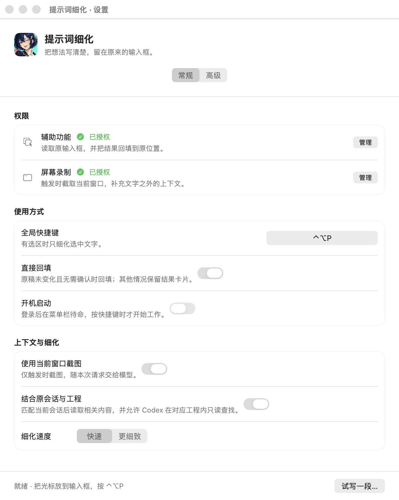
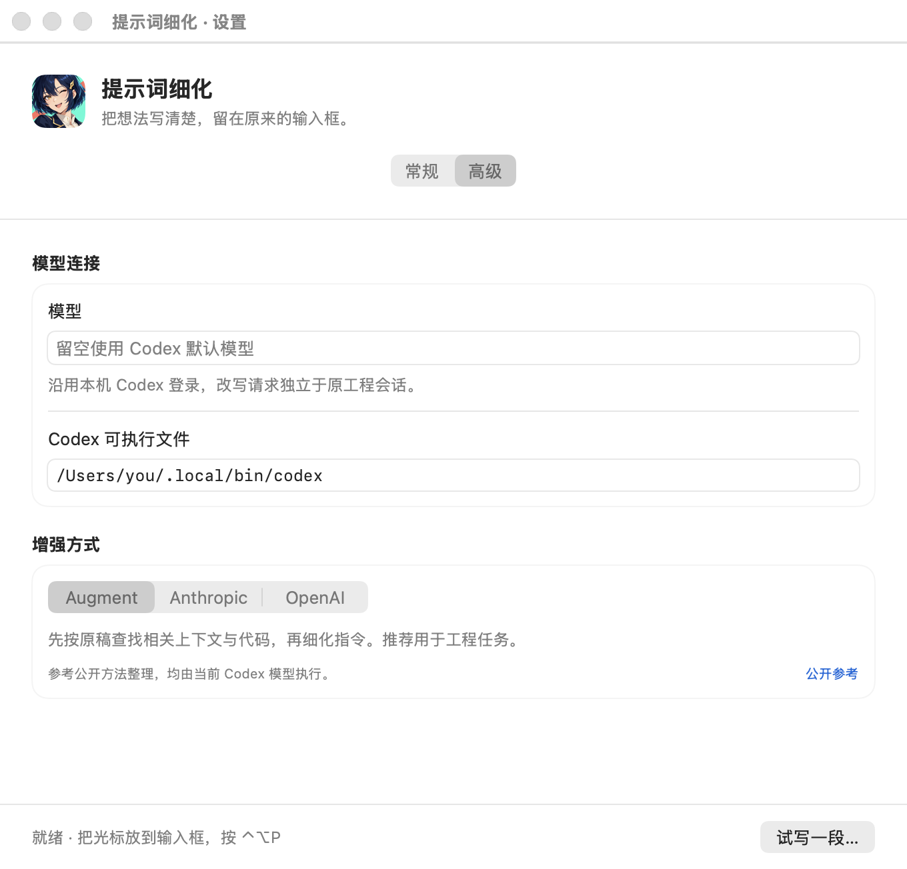

<p align="center"></p>

<h1 align="center">提示词细化 · PromptRefiner</h1>

<p align="center"><b>把随手写下的想法，变成更清楚的下一条指令。</b></p>
<p align="center">选中文字 · 快捷细化 · 留在原来的输入框</p>

<p align="center">
  <a href="https://github.com/lianshuang-photo/prompt-refiner/releases/tag/v0.3.4"></a>
  
  
  <a href="LICENSE"></a>
</p>

<p align="center">
  <a href="https://github.com/lianshuang-photo/prompt-refiner/releases/download/v0.3.4/PromptRefiner-v0.3.4-macOS-arm64.zip"></a>
</p>

<p align="center">
  <a href="#安装与首次测试">快速上手</a> ·
  <a href="https://github.com/lianshuang-photo/prompt-refiner/releases/tag/v0.3.4">更新说明</a> ·
  <a href="https://github.com/lianshuang-photo/prompt-refiner/issues">问题反馈</a>
</p>

---

PromptRefiner 是一个 **macOS 菜单栏提示词增强工具**。在输入框里写下想法，按 `⌃⌥P`，让本机 Codex 结合已有上下文把指令补得更清楚。原稿与目标没有变化时尝试回填；需要确认时保留可编辑结果，由你决定是否使用。

**当前下载版本：v0.3.4，开发预览版。** 安装包无需 Xcode 或 Python，使用时仍需自行安装并登录 Codex。项目与 OpenAI、Augment、Anthropic 没有官方隶属关系。

## 产品界面

<p align="center"></p>
<p align="center"><sub>从本版本原生界面导出的设置预览，路径使用示例数据。图片用于说明操作入口，兼容性范围见验证记录。</sub></p>

<details>
<summary><b>查看三种增强方式</b></summary>

<p align="center"></p>

三个选项参考公开方法整理，实际都由你当前配置的 Codex 模型执行；它们不是三家内部产品提示词，也不会切换服务商。

</details>

## 功能

| 功能 | 使用体验 |
| --- | --- |
| ⌨️ 快捷键与右键 | 默认 `Control + Option + P`，也可选中文字后使用「服务 → 细化提示词」。 |
| 🧩 结合上下文 | 可使用当前窗口截图、唯一匹配的原会话，以及对应工程的只读查询结果。 |
| ✍️ 三种增强方式 | Augment、Anthropic、OpenAI，默认选择 Augment。 |
| 🫧 生成进度 | 右上角小浮层显示处理阶段、用时和取消入口。 |
| ↩️ 回填与撤销 | 检查原稿及目标是否变化，保留预览、复制和撤销入口；不会自动发送消息。 |
| 🧷 菜单栏常驻 | 设置打开时显示 Dock 图标，关闭后留在菜单栏；开机启动可选。 |

### 三种增强方式

| 方式 | 侧重点 | 公开参考 |
| --- | --- | --- |
| **Augment（默认）** | 以原稿查找相关上下文与代码，再结合结果增强。 | [SDK 示例](https://github.com/augmentcode/auggie/blob/5f9e4efafbdd052b6f1aa8855e0067ccdc181040/examples/typescript-sdk/context/prompt-enhancer-server/enhance-handler.ts) |
| **Anthropic** | 精选关键上下文，用简单询问、复杂实施、已经明确三类示例控制补充程度。 | [上下文工程](https://www.anthropic.com/research/effective-context-engineering-for-ai-agents) |
| **OpenAI** | 保留已有结构、示例和用户约束，只补真实缺口，再对照原稿检查。 | [官方提示词生成指南](https://developers.openai.com/api/docs/guides/prompt-generation) |

## 使用前提

1. **Apple Silicon Mac（M 系列），macOS 14 或更高版本。** 本次提供 arm64 安装包，尚未发布 Intel 版本。
2. 本机已安装并登录 Codex，且有可用的模型访问权限。安装入口见 [OpenAI 官方 Codex CLI 文档](https://learn.chatgpt.com/docs/codex/cli)。
3. 工程增强需要 Codex CLI 支持命名的只读权限配置。已在 `0.162.0-alpha.17.2` 验证，并在本次打包后使用 `0.164.0-alpha.11.1` 完成工程模式抽测；其他版本的兼容性应以实际运行结果为准。

终端中可用 `codex login` 完成登录，用 `codex login status` 检查状态，见 [OpenAI 官方认证说明](https://learn.chatgpt.com/docs/auth)。本项目不分发 Codex 程序、模型或登录凭据，也不自动导入自定义 provider 配置。

## 安装与首次测试

从 [Releases 下载 PromptRefiner-v0.3.4-macOS-arm64.zip](https://github.com/lianshuang-photo/prompt-refiner/releases/download/v0.3.4/PromptRefiner-v0.3.4-macOS-arm64.zip)。

1. 解压，将 **PromptRefiner.app** 拖入「应用程序」文件夹，也可放到个人 `~/Applications`。以后从固定位置打开。
2. 启动 App，在菜单栏找到「笔尖＋星星」图标，打开设置。
3. 确认本机 Codex 已登录。若未自动找到程序，在「高级 → Codex 可执行文件」填写 `command -v codex` 得到的完整路径；也支持官方独立安装器的 `~/.local/bin/codex`。
4. 先点 **「试写一段…」**，输入一段不含敏感内容的文字，确认能返回改写结果。手动试写不需要读取其他应用。
5. 按需要授予辅助功能与屏幕录制权限，再回到目标输入框，选中文字并按 `⌃⌥P`，或使用右键服务。
6. 原稿和目标未变化时可回填；出现预览卡片时，检查后再应用或复制。结果不会自动发送。

### 首次打开被 macOS 拦截

当前安装包使用 **ad-hoc 签名，尚未通过 Apple 公证**。确认文件来自本仓库且未被篡改后，可按 [Apple 官方说明](https://support.apple.com/102445)，在尝试打开后前往「系统设置 → 隐私与安全性 → 仍要打开」。若系统提示文件损坏或检测到恶意内容，应停止运行并检查下载文件。

Release 附带 `SHA256SUMS.txt`。将它与 ZIP 放在同一个文件夹，可运行 `shasum -a 256 -c SHA256SUMS.txt` 校验下载内容。

### 更新后仍提示未授权

新版本的临时签名指纹可能变化，系统开关仍显示开启也可能对应旧版本。遇到此情况，在「隐私与安全性」中移除旧的 PromptRefiner 条目，再从固定安装位置重新添加当前 App，然后重新运行。

## 数据与权限

| 权限或数据 | 用途与范围 |
| --- | --- |
| 辅助功能 | 读取原输入框和选区、检查目标变化、回填与撤销。未授权时，右键传入的文字仍可改写，结果需复制。 |
| 屏幕录制 | 仅触发时截取已定位的当前窗口，可在设置中关闭。截图不可用时继续使用文字材料。 |
| 原会话与工程 | 仅唯一匹配时读取相关历史；工程查询保持只读，不续跑原会话，也不执行草稿中的任务。 |
| 模型请求 | 原稿、选用的截图及相关上下文会通过 Codex 发送给所选模型，并消耗相应账户用量。 |
| 本地记录 | 设置保存在本机；最近一次运行收据记录阶段、所选策略和材料长度等，不保存原稿、截图或模型正文。 |

临时请求目录在完成、失败或取消后清理。会话适配依赖 Conductor／Codex 的本地存储结构；不能可靠匹配时不会猜测。原数据库不会被改写，必要的兼容读取在私有临时副本中完成。

## 验证状态

核心功能通过 **39 项自动检查**。三种策略已完成 9 组合成输入的真实 Codex 验证，覆盖简单询问、工程任务和已经明确的指令；测试中遇到的限流请求经过重试。

回填依赖目标应用的辅助功能支持，尚未逐一验收所有应用和系统版本。打包完整性、真实模型调用和跨应用兼容性分别记录，详细范围见 [验证记录](docs/verification.md)。

## 从源码构建

需要完整 **Xcode 26 或更新版本**（包含 `actool` 图标编译器）。本机使用 Xcode 26.4.1；安装发布包无需这些开发工具。

```sh
git clone https://github.com/lianshuang-photo/prompt-refiner.git
cd prompt-refiner
swift test
zsh Scripts/build-app.sh
open dist/PromptRefiner.app --args --settings
```

生成可分发的 ZIP 和校验文件：

```sh
python3 Scripts/package-release.py
```

界面预览可通过 `zsh Scripts/render-readme-previews.sh` 重新导出。它使用隔离的演示配置，不启动改写、不发送请求，也不注册登录项。

开发诊断可用 `--smoke-check --draft-text '待增强的草稿'`，或添加 `--project /absolute/path/to/project`、`--image /absolute/path/to/screenshot.png`。这些真实请求会使用本机 Codex 登录并消耗用量。

## 组成与许可

- Swift／SwiftUI／AppKit 原生界面、菜单栏与全局快捷键。
- 独立的 Codex 调用、会话只读适配与输入框变化保护。
- 源码和发布包采用 [MIT License](LICENSE)，安装包内附许可证。
- 图标为 ImageGen 生成的原创角色，原图与提示词见 [Assets/IMAGEGEN.md](Assets/IMAGEGEN.md)。

## 移除

从菜单栏退出后删除 App 即可。按需要在系统设置中移除其权限与登录项；本机偏好及 `~/Library/Application Support/PromptRefiner/` 下的运行收据独立保留。
